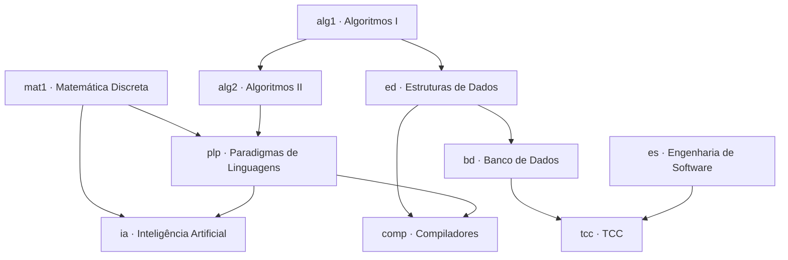

# Trilha Acadêmica · Modelagem NoSQL para matrícula e trajetórias

Protótipo em **MongoDB** do artigo técnico *"Trilha Acadêmica: modelagem NoSQL para matrícula e trajetórias em um curso de Engenharia de Software"*, desenvolvido para a disciplina do Prof. Silvio Bortoleto (Engenharia de Software, Unicesumar Curitiba, 2026).

**Grupo:** Kimberly Valle (R.A. 24422362-2) · Lucas Matheus Vaz (R.A. 24521968-2) · Mylena Alves (R.A. 26005558-2)

---

## O problema

Todo semestre, o aluno precisa escolher disciplinas respeitando uma rede de pré-requisitos, e a coordenação precisa planejar quantas turmas abrir. O cenário mistura dois formatos de dado:

- o **histórico do aluno**, um agregado lido inteiro de uma vez;
- os **pré-requisitos**, um grafo dirigido consultado de forma recursiva.

## Perguntas que o protótipo responde

| ID | Pergunta | Recurso do MongoDB |
| --- | --- | --- |
| C1 | Qual é o histórico completo do aluno? | `findOne` por `_id` |
| C2 | Quais disciplinas o aluno pode cursar agora? | `aggregate` com `$lookup` e `$setIsSubset` |
| C3 | Quais são todos os pré-requisitos, diretos e indiretos, de uma disciplina? | `$graphLookup` |
| C4 | Quais disciplinas ficam bloqueadas se o aluno reprovar em X? | `$graphLookup` no sentido inverso |
| C4b | Quantos alunos estão hoje travados por uma reprovação? | `$elemMatch` + índice multikey |
| C5 | Quais disciplinas mais reprovam? | `$unwind` + `$group` |
| C6 | Quantos alunos estarão aptos a cada disciplina no próximo semestre? | `$lookup` + `$group` |

## Modelagem

Duas coleções:

**`disciplinas`**: cada documento referencia seus pré-requisitos diretos. Essa lista é a aresta do grafo.

```json
{ "_id": "comp", "nome": "Compiladores", "periodo": 4, "creditos": 4,
  "prerequisitos": ["plp", "ed"] }
```

**`alunos`**: o histórico fica incorporado no documento do aluno, com uma entrada por tentativa.

```json
{ "_id": "RA24000073", "nome": "Carla Costa", "curso": "Engenharia de Software", "ingresso": "2025.1",
  "historico": [
    { "disciplina": "alg1", "semestre": "2025.1", "nota": 6.6, "situacao": "aprovado" },
    { "disciplina": "alg2", "semestre": "2025.2", "nota": 2.8, "situacao": "reprovado" }
  ] }
```

| Dado | Decisão | Motivo |
| --- | --- | --- |
| Histórico | Incorporar no aluno | Lido sempre inteiro (C1), tamanho limitado, escrita atômica por documento |
| Pré-requisitos | Referenciar por código | Relação muitos-para-muitos, compartilhada e percorrida de forma recursiva |
| Nome da disciplina no histórico | Não duplicar | Evita cópias a sincronizar; busca via `$lookup` quando necessário |

### Grafo de pré-requisitos



## Dados

Todos os dados são **fictícios** e gerados pelo próprio script, com semente fixa (`2026`), então qualquer execução produz exatamente a mesma base:

- 10 disciplinas de 4 períodos;
- 300 alunos em 5 turmas de ingresso (2024.1 a 2026.1);
- 2.153 registros de histórico, com taxas de aprovação simuladas por disciplina e limite de 12 créditos por semestre.

## Como executar

### 1. Subir o MongoDB

Com Docker:

```bash
docker compose up -d
```

Ou use qualquer MongoDB 6.0+ rodando em `localhost:27017`.

### 2. Instalar a dependência e rodar

```bash
python -m venv .venv
source .venv/bin/activate        # no Windows: .venv\Scripts\activate
pip install -r requirements.txt
python trilha_prototipo.py
```

O script recria o banco `trilha`, insere os dados, cria os índices, executa as consultas C1 a C6 e grava tudo em `resultados.json`.

> ⚠️ O script apaga e recria as coleções `disciplinas` e `alunos` do banco `trilha` a cada execução.

## Resultados obtidos

O arquivo [`resultados_exemplo.json`](resultados_exemplo.json) traz a saída completa de uma execução. Destaques:

- **C1:** a leitura do histórico examinou **1 documento**.
- **C2:** a aluna RA24000073, reprovada duas vezes em Algoritmos II, pode cursar `alg2` e `tcc`.
- **C3:** Compiladores exige `ed` e `plp` diretamente, e `alg1`, `alg2` e `mat1` indiretamente.
- **C4:** reprovar em Algoritmos II bloqueia `plp` e, por consequência, `comp` e `ia`.
- **C4b:** 23 alunos estão travados por `alg2`; a consulta usou o índice multikey (IXSCAN) e examinou 55 documentos em vez de 300.
- **C5:** as maiores taxas de reprovação são de Compiladores (34,8%) e Matemática Discreta (30,5%); a média geral é 22,2%.
- **C6:** Compiladores (83), Algoritmos II (82) e Estruturas de Dados (80) teriam a maior demanda no próximo semestre.

## Estrutura do repositório

```
.
├── trilha_prototipo.py      # carga dos dados, índices e consultas C1 a C6
├── resultados_exemplo.json  # saída de uma execução
├── requirements.txt         # dependência (pymongo)
├── docker-compose.yml       # MongoDB local para testes
└── README.md
```

## Limitações

- Dados fictícios de um único curso.
- Regras como carga horária mínima, co-requisitos, equivalências e choque de horário ficaram fora do recorte. Por isso o TCC aparece liberado para alunos do 3º período.
- MongoDB em um único nó, sem réplicas. Os tempos de resposta não foram medidos em escala.

## Tecnologias

MongoDB 8 · Python 3 · PyMongo
